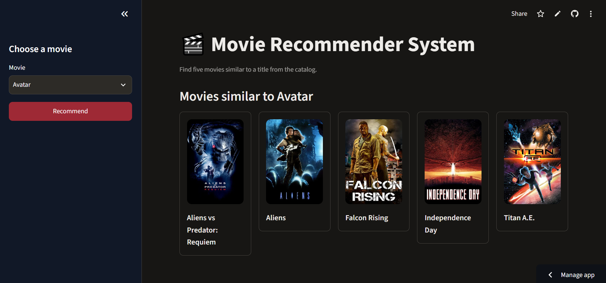
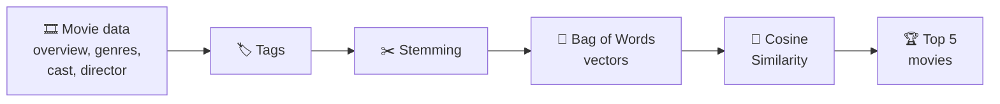

<div align="center">

# 🎬 Movie Recommender System

### *Can't decide what to watch tonight? Pick one movie you love, and get 5 more you'll probably love too.*

[](https://samadhanekad-movie-recommender-system-frontendapp-2g2ogd.streamlit.app)


</div>

<p align="center">
  
</p>

---

## ✨ See It in Action

Choose **Avatar** and the app recommends:

| # | Recommended movie |
|:-:|---|
| 1 | 👽 Aliens vs Predator: Requiem |
| 2 | 🚀 Aliens |
| 3 | 🔫 Falcon Rising |
| 4 | 🛸 Independence Day |
| 5 | 🪐 Titan A.E. |

Sci-fi, aliens and space adventures. The app understood the *feel* of the movie. 🎯

**How to use:** open the [live app](https://samadhanekad-movie-recommender-system-frontendapp-2g2ogd.streamlit.app) → pick a movie → click **Recommend** → enjoy 🍿

---

## 🧠 How Does It Think?

The app uses **Content-Based Filtering**: *"If you liked this movie, you'll like movies with similar content."*



| Step | What happens | Simple example |
|---|---|---|
| 1. Tags | Overview, genres, keywords, top 3 actors and director become one text | `action scifi samworthington jamescameron ...` |
| 2. Stemming | Words are cut to their root | *loved, loving* → *love* |
| 3. Vectors | Each movie turns into 5000 numbers (word counts) | `[0, 2, 0, 1, ...]` |
| 4. Similarity | Angle between two movies is measured | 1 = twins, 0 = nothing in common |
| 5. Recommend | Highest scores win | Top 5 shown with posters |

---

## 🛠️ Tools and Technologies

| Area | Tools |
|---|---|
| 🐍 Language | Python |
| 📊 Data handling | pandas, numpy, ast |
| 💬 Text processing (NLP) | NLTK (PorterStemmer) |
| 🤖 Machine learning | scikit-learn (CountVectorizer, cosine_similarity) |
| 💾 Saving the model | pickle |
| 🎨 Web app | Streamlit |
| 🖼️ Posters | TMDB API + requests (with retry and caching) |
| 💻 Development | Jupyter Notebook, VS Code |
| ☁️ Hosting | Git, GitHub, Streamlit Community Cloud |

**Dataset:** [TMDB 5000 Movies and Credits](https://www.kaggle.com/datasets/tmdb/tmdb-movie-metadata)

---

## 📁 Project Structure

```
Movie_Recommender_System/
├── 🧪 backend/
│   ├── movie_recommender_system.ipynb   # builds the model (run once)
│   ├── recommender.py                   # loads the model, recommends, fetches posters
│   ├── movie_dict.pkl                   # saved movie data
│   └── similarity.pkl                   # saved similarity matrix
├── 🎨 frontend/
│   └── app.py                           # Streamlit user interface
├── 📂 raw_data/                         # TMDB csv files
├── requirements.txt
└── README.md
```

> 🧩 **Notebook** builds the brain once → **recommender.py** uses the brain → **app.py** shows the result.

---

## ▶️ Run It on Your Computer

```bash
# 1. Install libraries
pip install -r requirements.txt

# 2. Add your free TMDB API key
#    Create the file  .streamlit/secrets.toml  and write:
#    TMDB_API_KEY = "your_key_here"

# 3. Start the app
streamlit run frontend/app.py
```

🔑 Get a free key at [themoviedb.org](https://www.themoviedb.org/settings/api).

<details>
<summary>🔁 Want to rebuild the model?</summary>

Open the notebook in `backend/` and run all cells. It also needs `scikit-learn` and `nltk`:

```bash
pip install scikit-learn nltk
```
</details>

<details>
<summary>☁️ Deploy your own copy (free)</summary>

1. Push the code to GitHub (never push the secrets file).
2. Go to [share.streamlit.io](https://share.streamlit.io) and click **Create app**.
3. Select the repo, branch `main`, main file `frontend/app.py`.
4. In **Advanced settings > Secrets**, add `TMDB_API_KEY = "your_key_here"`.
5. Click **Deploy**.
</details>

---

## 🏗️ What I Built

- ✅ Cleaned and merged the TMDB movies and credits data
- ✅ Built a content-based recommendation model using NLP and cosine similarity
- ✅ Saved the model as pickle files and separated backend from frontend
- ✅ Built a Streamlit interface that shows recommendations with posters
- ✅ Added retry and caching for poster requests, with a placeholder when a poster is missing
- ✅ Deployed it online for free

## 📚 What I Learned

- 💡 How **recommendation systems** work behind apps like Netflix
- 💡 Text processing for ML: tags, stemming, Bag of Words, cosine similarity
- 💡 Why stemming must come **before** vectorizing
- 💡 Saving and loading models with **pickle**, and GitHub's 100 MB file limit
- 💡 Calling a **REST API** with timeouts, retries and error handling
- 💡 Keeping **API keys secret** using Streamlit Secrets
- 💡 Structuring a project into backend and frontend
- 💡 **Git, GitHub** and deploying on **Streamlit Cloud**

---

## 🔮 What's Next

- 🔍 Search box with auto-suggestions
- ⭐ Rating, release year and overview for each movie
- 🎭 Filter by genre
- 🤝 Hybrid model (content + user ratings)

---

<div align="center">

**Made with ❤️ by [Samadhan Ekad](https://github.com/SamadhanEkad)**

⭐ If you liked this project, give it a star!

</div>
